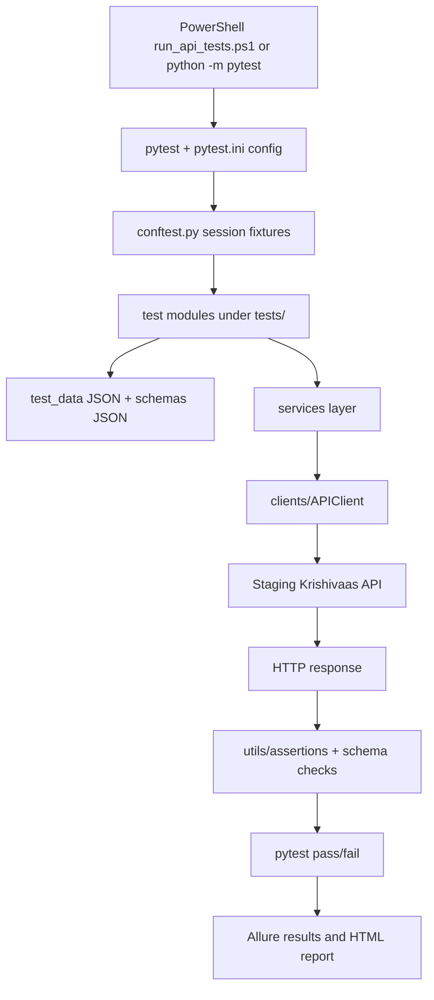
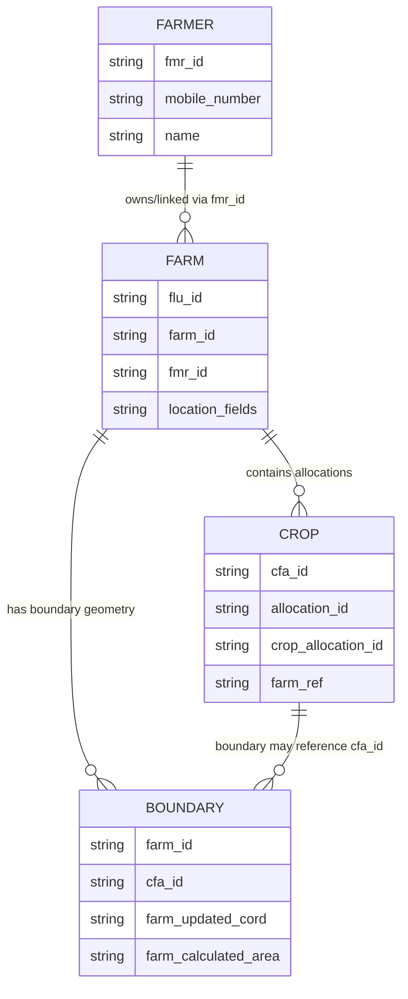

# Krishivaas Onboarding API Automation

## Purpose and scope

This repository automates staging API validation for:
- Authentication/token readiness
- Farmer APIs
- Farm APIs
- Crop APIs
- Boundary APIs
- End-to-end workflow chaining farmer -> farm -> crop -> boundary

The suite is integration-focused and uses realistic multipart/form or form-encoded payloads against staging endpoints.

## Repository map and responsibilities

- `clients/`: HTTP session wrapper (`APIClient`) with shared headers, base URL handling, and request dispatch.
- `config/`: environment-driven runtime settings (`API_BASE_URL`, `API_TOKEN`, timeouts, TLS behavior).
- `services/`: API operation wrappers for farmer, farm, crop, and boundary endpoints.
- `schemas/`: JSON schema files used by assertions (currently scaffolds/placeholders per existing implementation notes).
- `test_data/`: request payload fixtures for add/update scenarios.
- `tests/`: integration tests by domain (`farmer`, `farm`, `crop`, `boundary`) plus workflow tests.
- `utils/`: data loading, assertions/schema validation, multipart helpers, logging, and Allure attachments.
- `conftest.py`: session fixture setup for `api_client`; enforces token presence and closes session.
- `pytest.ini`: test discovery configuration, default pytest options, and integration marker definition.
- `requirements.txt`: Python dependencies for requests, pytest, dotenv, allure-pytest, and jsonschema.
- `run_api_tests.ps1`: PowerShell runner for full pytest execution plus Allure report generation/opening.

## Execution architecture (test run flow)



## Logical data model (inferred for tests)

> **Logical/inferred model only** (derived from test payloads and assertions, not a confirmed backend ERD).



### Identifier uncertainty to confirm with API contract

- `fmr_id`: used as farmer identifier across farmer/farm/crop workflow tests.
- `flu_id` vs `farm_id`: both appear in requests/responses as farm identifiers depending on endpoint.
- Crop allocation identifier: tests probe `cfa_id`, `allocation_id`, and `crop_allocation_id` because response contract is not finalized.
- `cfa_id` in boundary operations: currently passed through for update/create-like boundary flows but contract semantics remain to be verified.

## Setup (Windows PowerShell)

From the repository root:

```powershell
py -m venv .venv
.\.venv\Scripts\python.exe -m pip install -r requirements.txt
Copy-Item .env.example .env
notepad .env
```

Add a fresh staging `API_TOKEN`, a valid `MAPINDIA_TOKEN`, and a unique approved `TEST_MOBILE_NUMBER`. Do not commit `.env`.

## Targeted test execution

```powershell
.\.venv\Scripts\python.exe -m pytest --collect-only -v
.\.venv\Scripts\python.exe -m pytest tests/test_auth.py -v
.\.venv\Scripts\python.exe -m pytest tests/farmer -v -s
.\.venv\Scripts\python.exe -m pytest tests/farm -v -s
.\.venv\Scripts\python.exe -m pytest tests/crop -v -s
.\.venv\Scripts\python.exe -m pytest tests/boundary -v -s
.\.venv\Scripts\python.exe -m pytest tests/workflows -v -s
```

## Full suite execution

```powershell
.\.venv\Scripts\python.exe -m pytest tests/ -v -s
```

Or use the bundled runner:

```powershell
./run_api_tests.ps1
```

## Allure reporting

Run with results output:

```powershell
.\.venv\Scripts\python.exe -m pytest tests -v --alluredir=allure-results
allure serve allure-results
```

Install adapter:

```powershell
.\.venv\Scripts\python.exe -m pip install allure-pytest
```

Install Allure CLI (Node.js/npm required):

```powershell
npm install -g allure-commandline
allure --version
```

Run one test:

```powershell
.\.venv\Scripts\python.exe -m pytest tests/farmer/test_add_farmer.py -v -s --alluredir=allure-results --clean-alluredir
allure serve allure-results
```

Run all tests with clean Allure output:

```powershell
.\.venv\Scripts\python.exe -m pytest tests/ -v -s --alluredir=allure-results --clean-alluredir
allure serve allure-results
```

Generate a persistent report:

```powershell
allure generate allure-results --clean -o allure-report
allure open allure-report
```

## Configuration and secrets guidance

- Configure runtime values through environment variables consumed by `config/settings.py`.
- Core values: `API_BASE_URL`, `WEB_BASE_URL`, `API_TOKEN`, `REQUEST_TIMEOUT`, `VERIFY_TLS`.
- Keep tokens and any environment files out of source control.
- Use only approved staging tenant/test records; avoid production credentials/data.

## Important implementation notes

- Use only an approved staging tenant and test records. Add tests create records; update tests mutate records.
- Requests automatically creates the multipart `Content-Type` boundary when `data`/`files` are used. Do not copy browser-generated multipart boundary headers.
- The bearer token is taken from `.env`. The API also included a `token` form field in the supplied cURLs, so the service payloads preserve that field where shown.
- Farmer/farm/crop response bodies and status codes were not included in the prompt. Tests currently accept HTTP 200 or 201; align this with the actual API contract.
- The JSON schemas are placeholders, not verified contracts. Replace them after capturing successful and error response examples.
- `farm_id` and `cfa_id` semantics for boundary create/update must be confirmed. Your boundary cURL supplies `farm_id` and `cfa_id`; this scaffold retains both.
- The provided cURLs do not include an add-boundary-specific request, crop cancel endpoint, or complete edit-crop response contract. Add-boundary currently uses the same endpoint as update, per your note. Cancel crop is skipped rather than guessing an endpoint.
- `flu_id` appears to identify a farm in the supplied requests, while `fmr_id` appears to identify a farmer; verify these names with the API contract.

## Security warnings

- Review response attachments for personal or confidential data before using reports outside your machine.
- Never commit `.env`, tokens, or cookies.

## Assumptions

- Tests are intended for staging integration use, not isolated unit testing.
- Endpoint behavior and field names may vary until validated against finalized API contracts.
- Existing workflow tests rely on dynamic ID extraction from response bodies and may need key updates if contracts change.

## Verification notes

- This README is intentionally self-contained for onboarding, execution, architecture flow, and logical data-model context.
- Diagrams are documentation aids and do not alter runtime behavior.
- All commands and paths above are repository-relative where applicable.
