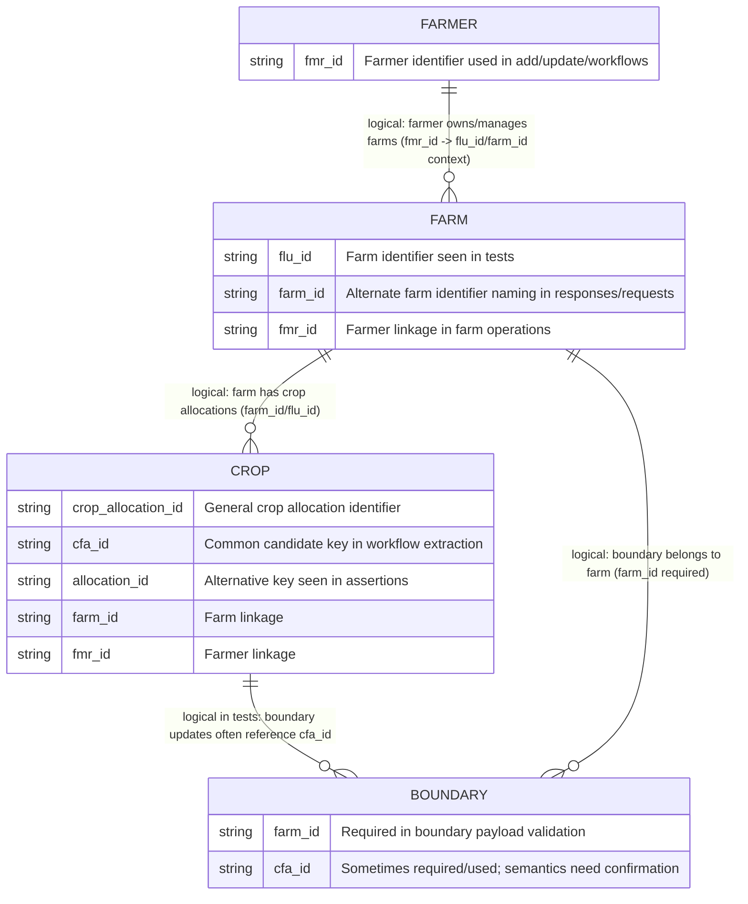

# Project Architecture: Krishivaas Onboarding API Automation

## Purpose and scope
This repository automates **staging API** validation for the Krishivaas onboarding domain. Test coverage is centered on:
- Authentication/token readiness (`tests/test_auth.py`)
- Farmer operations (`fmr_id` lifecycle)
- Farm operations (`flu_id`/`farm_id` references)
- Crop operations (crop allocation identifiers such as `cfa_id`/`allocation_id`)
- Boundary operations (farm boundary update/add behavior using the same endpoint pattern currently used in tests)

The focus is integration-style API testing with pytest + Allure reporting against approved staging data.

## Repository layout and responsibilities
- `clients/` - HTTP client abstraction (`APIClient`) over `requests.Session`, base URL, auth header, timeout, and request dispatch.
- `config/` - runtime settings loaded from environment (`API_BASE_URL`, `API_TOKEN`, timeout/TLS flags, helper `env_id`).
- `services/` - domain service wrappers (farmer, farm, crop, boundary) mapping test intent to API endpoints/payload shapes.
- `schemas/` - JSON schema files used for response validation scaffolding in tests/utilities.
- `test_data/` - reusable JSON payload templates for add/update operations.
- `tests/` - pytest suites (feature tests + workflow/E2E sequences under `tests/workflows`).
- `utils/` - shared helpers for assertions, schema loading, multipart form shaping, and Allure-safe response attachments.
- `/home/runner/work/Api-testing/Api-testing/conftest.py` - session fixture bootstrap and API token guard for integration tests.
- `/home/runner/work/Api-testing/Api-testing/pytest.ini` - pytest discovery paths/patterns and integration marker registration.
- `/home/runner/work/Api-testing/Api-testing/requirements.txt` - Python dependency set (`pytest`, `requests`, `allure-pytest`, `jsonschema`, `python-dotenv`).
- `/home/runner/work/Api-testing/Api-testing/run_api_tests.ps1` - PowerShell entry script for running pytest and generating/opening Allure HTML output.

## End-to-end execution flow

```mermaid
flowchart LR
    A[PowerShell entry: run_api_tests.ps1\nor direct pytest command] --> B[pytest + pytest.ini discovery/options]
    B --> C[conftest.py session fixture\nload .env and create APIClient]
    C --> D[tests/ read test_data/*.json\nand optional schemas/*.json]
    D --> E[services/*_service.py\ncompose domain payloads/endpoints]
    E --> F[clients/api_client.py\nrequests.Session request]
    F --> G[Staging API\napi.staging.krishivaas.com]
    G --> H[utils/assertions.py\nstatus/JSON/schema checks]
    H --> I[Allure output\nallure-results -> allure-report]
```


## Logical domain/test-data ER model (not authoritative DB schema)
> This ER is a **logical test-data relationship model** inferred from repository payloads/tests and README notes, not a verified backend database schema.



## Test execution workflow and commands
1. Prepare Python virtual environment and install dependencies.
2. Configure `.env` with staging credentials/tokens and test mobile number.
3. Run targeted suites during development.
4. Run full suite with Allure result output.
5. Serve or generate Allure report for investigation.

Representative commands (aligned with README):
```powershell
# Setup
py -m venv .venv
.\.venv\Scripts\python.exe -m pip install -r requirements.txt

# Discovery and targeted suites
.\.venv\Scripts\python.exe -m pytest --collect-only -v
.\.venv\Scripts\python.exe -m pytest tests/test_auth.py -v
.\.venv\Scripts\python.exe -m pytest tests/farmer -v -s
.\.venv\Scripts\python.exe -m pytest tests/farm -v -s
.\.venv\Scripts\python.exe -m pytest tests/crop -v -s
.\.venv\Scripts\python.exe -m pytest tests/boundary -v -s
.\.venv\Scripts\python.exe -m pytest tests/workflows -v -s

# Run all tests + Allure results
.\.venv\Scripts\python.exe -m pytest tests -v --alluredir=allure-results
allure serve allure-results

# Optional helper script
.\run_api_tests.ps1
```

## Configuration and secrets guidance
- Use a local `.env` file for runtime configuration (never commit it).
- Minimum sensitive values for staging runs:
  - `API_TOKEN` (fresh staging bearer token)
  - `MAPINDIA_TOKEN` (token used in farmer/farm data templates)
  - `TEST_MOBILE_NUMBER` (unique approved test number)
- Additional IDs (for update/workflow paths) may be required, e.g. existing farmer/farm/crop/boundary IDs.
- Do **not** commit tokens, credentials, or response artifacts containing personal/sensitive data (including exported report bundles).

## Assumptions and verification notes
Based on current README and test scaffolding:
- JSON schemas in `schemas/` are placeholders/scaffolds and not yet authoritative API contracts.
- Response status/body contracts are partially uncertain; tests often accept `200` or `201` pending contract confirmation.
- Multipart behavior relies on Python `requests` auto-generated boundaries (manual boundary headers should not be copied from browser cURL).
- Boundary add/update currently targets the same endpoint in service/tests; backend behavior should be confirmed.
- Identifier semantics remain partially uncertain and should be validated with API owners:
  - `flu_id` vs `farm_id` naming/usage
  - crop allocation key variants (`cfa_id`, `allocation_id`, `crop_allocation_id`)
  - whether `cfa_id` is mandatory for all boundary operations
